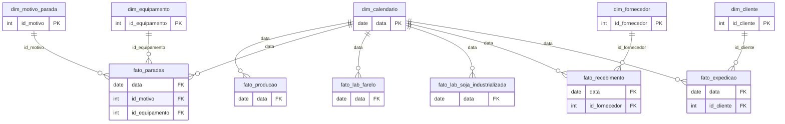

# Modelo de dados da Esmagadora Modelo

Diagrama das tabelas da base e três críticas ao modelo, escritas como se eu fosse usar estes dados para responder perguntas de negócio.

## Diagrama

A base segue um **esquema estrela**: as tabelas fato guardam eventos e medições (uma linha por dia, por carga ou por análise) e as tabelas dimensão guardam os cadastros. Cada dimensão aparece do lado **1** da ligação e cada fato do lado **N**. O calendário fica no centro, ligado às seis fatos pela `data`.

| Ligação | Chave | Tipo |
|---|---|---|
| `dim_calendario` → as seis fatos | `data` | 1:N (em `fato_producao` e `fato_lab_soja_industrializada`, na prática 1:1, porque o grão é 1 dia) |
| `dim_motivo_parada` → `fato_paradas` | `id_motivo` | 1:N |
| `dim_equipamento` → `fato_paradas` | `id_equipamento` | 1:N (vazio quando a parada não é de um equipamento) |
| `dim_fornecedor` → `fato_recebimento` | `id_fornecedor` | 1:N |
| `dim_cliente` → `fato_expedicao` | `id_cliente` | 1:N |

## Três críticas ao modelo

### 1. Falta a qualidade do óleo

A base tem a qualidade da soja que entra (`fato_lab_soja_industrializada`) e do farelo que sai (`fato_lab_farelo`), mas nada sobre o óleo degomado. Metade do produto da fábrica fica sem controle de qualidade nos dados.

**Proposta:** uma tabela `fato_lab_oleo` (uma linha por análise), com `data`, `turno` e as análises do óleo degomado, como acidez, fósforo, umidade e voláteis e impurezas insolúveis.

**Pergunta que passa a ter resposta:** a degomagem está funcionando? Sem o fósforo do óleo, não dá para acompanhar a degomagem nem comparar a aquosa com a enzimática.

### 2. Produto é texto, não cadastro

`fato_expedicao` e `dim_cliente` guardam o produto como texto ("Farelo" ou "Óleo"). Texto solto é sujeito a variação de escrita ("Farelo", "farelo", "Farelo 46%") e não guarda atributos do produto.

**Proposta:** uma `dim_produto` (`id_produto`, produto, especificação, unidade), ligada a `fato_expedicao` e, no futuro, a `fato_estoque` e a `fato_lab_oleo` pelo `id_produto`. Separar a expedição em uma tabela por produto não resolve: seriam tabelas iguais que precisariam ser juntadas para qualquer total.

**Pergunta que passa a ter resposta:** expedição, estoque e qualidade por produto, sempre com o mesmo filtro e a mesma escrita.

### 3. O estoque está dentro da produção

`fato_producao` guarda os estoques de fechamento de soja, farelo e óleo. Estoque não é um evento de produção: é uma fotografia de como as coisas estavam no fim do dia, e muda também por recebimento e expedição.

**Proposta:** uma `fato_estoque` do tipo fotografia periódica: uma linha por dia, por produto e por local (silo, armazém, tanque), com `quantidade_t`. A produção fica só com o que foi produzido e consumido.

**Pergunta que passa a ter resposta:** cobertura de estoque por produto e por local, e capacidade ocupada de cada armazém, sem depender da tabela de produção.

## Outras melhorias

- **Pedidos de venda para calcular o OTIF.** A base não tem data prometida nem quantidade pedida. Uma `fato_pedido` (`id_pedido`, `id_cliente`, produto, `data_prometida`, `quantidade_pedida`), com a expedição apontando para o pedido, permitiria calcular o OTIF com qualquer regra de prazo. Guardar o fato e calcular o indicador, em vez de gravar uma coluna "entregue no prazo" (sim ou não) que esconde a regra.
- **Produção por turno.** O laboratório mostra o residual de óleo por turno, mas a produção só existe por dia. Dá para ver o sintoma por turno (residual maior num turno), mas não investigar a causa (carga, horas paradas e produtividade daquele turno).
